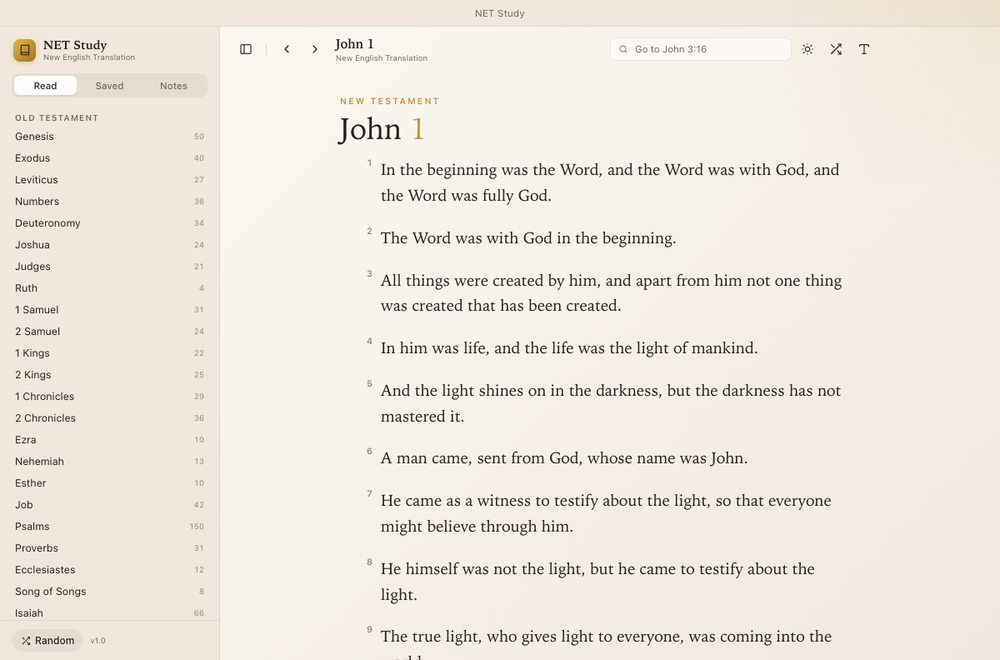

# NET Study (Electron)

A quiet study Bible reader for the New English Translation, ported from the native
macOS app in `../netstudyapp`. Same core logic, same data model, same look, but it
runs on Windows (and macOS/Linux) as an Electron app with no build step for the UI.



## Same core as the Mac app

| Original (Swift) | Port (JavaScript) |
| --- | --- |
| `Models.swift` — canon, aliases, `Reference.parse`, `PassageQuery` | `src/core/bible.js` |
| `BibleAPI.swift` — memory cache → network → disk cache, FNV-1a cache names | `src/api.js` |
| `Store.swift` — `PersistedState`, debounced saves, bookmarks/notes/highlights | `src/store.js` + renderer state |
| `AppStore` actions (load, next/prev, history, note/highlight rules) | `renderer/app.js` |
| `ReaderView` / `SidebarView` / `Theme` | `renderer/index.html`, `styles.css`, `app.js` |

The parser keeps every behaviour of the Swift version: longest-alias matching with
word boundaries (`Johnny 3` is not John), `Jude 3` read as verse 3 of a single-chapter
book, `Genesis:2` read as `1:2`, chapter clamping, `votd` / `random`, and semicolon
lists (`John 3:16-17; Psalms 23`).

## What it does

- **Full reference navigation** — 66 books with chapter grids plus a "Go to" field.
- **Verse actions** — click a verse number (or the dots on hover) to highlight in five
  colors, bookmark, copy with reference, or write a note.
- **Saved & Notes** in the sidebar, jumping back to the passage.
- **Verse of the Day** and **random passages**.
- **Offline cache** — every passage read is cached on disk.
- Light / dark / system appearance, adjustable size, column width, serif toggle.

## Run it

```bash
npm install
npm start
```

## Build a Windows app

```bash
npm run dist:win
```

That produces an NSIS installer and a portable `.exe` in `dist/`. Building on macOS
requires Wine for the installer step; `npm run dist:win -- --dir` produces an
unpacked, runnable folder without it. `npm run dist:mac` and `npm run dist:linux`
work the same way.

## Keyboard shortcuts

| Shortcut | Action |
| --- | --- |
| `Ctrl+F` | Focus the reference field |
| `Ctrl+D` | Verse of the Day |
| `Ctrl+R` | Random verse |
| `Ctrl+]` / `Ctrl+[` | Next / previous chapter |
| `Ctrl+Alt+S` | Toggle sidebar |
| `Ctrl+,` | Reading settings |
| `Ctrl+=` / `Ctrl+-` | Larger / smaller text |

On macOS use `Cmd` instead of `Ctrl`.

## Data

Notes, highlights, bookmarks, history and preferences are stored locally:

- Windows: `%APPDATA%\NET Study\state.json`
- macOS: `~/Library/Application Support/NET Study/state.json`
- Linux: `~/.config/NET Study/state.json`

Passage cache lives in `passages/` beside it. Nothing is sent anywhere except the
passage reference to `labs.bible.org`.

## Project layout

```
src/core/bible.js   canon, reference parser, passage queries (shared)
src/api.js          NET Bible API client + disk cache (main process)
src/store.js        state.json read/write with validation
src/main.js         window, menus, IPC, title bar
src/preload.js      contextBridge API
renderer/           index.html, styles.css, app.js
scripts/smoke.js    drives the real UI and asserts behaviour
```

`scripts/smoke.js` runs against a throwaway data directory and checks loading,
selection, highlights, bookmarks, notes, search, chapter navigation, multi-passage
requests, persistence and theming:

```bash
./node_modules/.bin/electron scripts/smoke.js
```

## Attribution

Scripture text is the **New English Translation (NET Bible)**, © Biblical Studies
Press, served through the public NET Bible API at `labs.bible.org`. This app is an
unofficial reader and is not affiliated with Bible.org.
